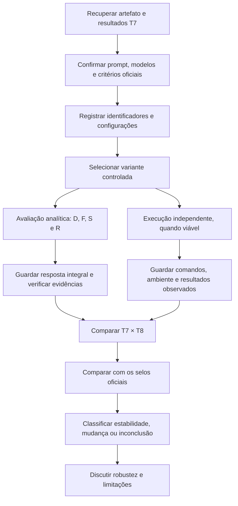

# Fluxograma — Tarefa 8

## Explicação

1. A linha de base da Tarefa 7 é recuperada sem alterar os resultados originais.
2. Cada variante registra modelo, versão, esforço, prompt e data.
3. A avaliação analítica e a execução são registradas separadamente.
4. As evidências citadas são conferidas diretamente no repositório.
5. A comparação considera mudanças de decisão, qualidade das evidências e concordância com a execução.
6. A conclusão responde à robustez sem presumir que versões mais novas ou maior esforço sejam necessariamente melhores.
