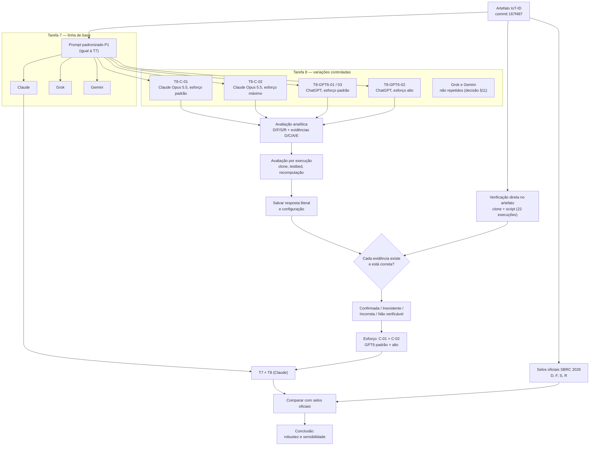

# Tarefa 8: relatório final

**Robustez das avaliações de artefatos por LLMs a mudanças de versão e de esforço de raciocínio**

Artefato: *IoT-ID: Deterministic Device Identity from Hybrid Network Fingerprinting* (SBRC 2026, Salão de Ferramentas), commit `167f487`. Selos oficiais: **D, F, S, R**.

## 1. Pergunta e resposta curta

**Pergunta:** os resultados obtidos na Tarefa 7 são robustos quando alteramos a versão dos modelos e/ou aumentamos o esforço usado na avaliação?

**Resposta:**

- **Para o Claude, os veredictos são robustos ao esforço.** Com o mesmo modelo, prompt e ambiente, o esforço padrão e o máximo chegaram às mesmas decisões para D, F, S e R. O esforço máximo não mudou nenhum selo; aumentou a cobertura e a profundidade das evidências, sem nenhuma evidência falsa.
- **Em relação à T7, o Claude mudou só em F** ("execução parcial" → "atendido com ressalvas"). A mudança é sustentada por evidência nova, a execução do pipeline completo em laboratório, e se explica sobretudo pela **capacidade de execução do ambiente**, não pela versão do modelo. D, S e R permaneceram iguais.
- **No ChatGPT (só T8), o fator dominante foi o acesso ao artefato.** As três rodadas falharam no clone por DNS, não executaram nada e chegaram ao mesmo veredicto qualitativo. Só a rodada de esforço alto apontou a divergência `stable`/`rich`.
- **Nenhuma configuração reproduz o selo R oficial**, e essa divergência é **sustentada por evidência verificada**: o código publicado não regenera 3 dos 12 hashes publicados a partir dos próprios dados dos autores.

## 2. Desenho experimental

| Família | Linha de base T7 | Rodadas T8 | Variável estudada |
|---|---|---|---|
| Claude (Anthropic) | Sim (versão não registrada; chat web) | T8-C-01 (padrão), T8-C-02 (máximo) | **Esforço**, isolado (mesmo modelo Claude Opus 5.5, prompt, ambiente e data); e T7 → T8 |
| ChatGPT (OpenAI) | Não (não usado na T7) | T8-GPT6-01 (padrão), T8-GPT6-02 (alto), T8-GPT6-03 (padrão, plano gratuito) | Esforço e estabilidade intra-provedor, só dentro da T8 |
| Grok, Gemini | Sim | Não repetidos (decisão metodológica, ver [protocolo §11](PROTOCOLO_EXPERIMENTAL.md)) | — |

Prompt: `docs/PROMPT_PADRONIZADO.md`, **igual ao da T7** em todas as rodadas. Configurações completas: [CONFIGURACOES_MODELOS.md](CONFIGURACOES_MODELOS.md). Respostas literais: [respostas/](respostas/).

Referência para julgar as evidências: [VERIFICACAO_COMPLETA_ARTEFATO.md](VERIFICACAO_COMPLETA_ARTEFATO.md), feita a partir de um clone próprio com script reexecutável. Fichas e conferência por rodada: [T8_CLAUDE_VERIFICACAO.md](T8_CLAUDE_VERIFICACAO.md) e [T8_GPT6_03_VERIFICACAO.md](T8_GPT6_03_VERIFICACAO.md).

## 3. Tabela comparativa T7 × T8

### 3.1 Selos

| Configuração | D | F | S | R | Acesso / execução |
|---|---|---|---|---|---|
| **Oficial SBRC 2026** | **Concedido** | **Concedido** | **Concedido** | **Concedido** | — |
| Claude T7 | Atende c/ ressalvas | Execução parcial | Atende c/ ressalvas | Reprodução parcial c/ divergências | Acessou; executou componentes |
| **Claude T8-C-01 (padrão)** | Atendido c/ ressalvas | Atendido c/ ressalvas | Atendido c/ ressalvas | Parcialmente atendido | Clone + pipeline em testbed |
| **Claude T8-C-02 (máximo)** | Sustentado | Sustentado c/ ressalvas | Sustentado c/ ressalvas | Parcialmente sustentado | Clone + pipeline em laboratório |
| ChatGPT T8-GPT6-01 (padrão) | Favorável | Não confirmada por execução | Favorável c/ ressalvas | Não verificada | Clone falhou (DNS) |
| ChatGPT T8-GPT6-02 (alto) | Favorável | Pipeline não executado | Favorável c/ ressalvas | Integral não demonstrada | Clone falhou (DNS) |
| ChatGPT T8-GPT6-03 (padrão, gratuito) | Atendido | Não validado independentemente | Favorável c/ ressalvas | Parcialmente demonstrada | Clone falhou (DNS) |
| *Grok T7 (referência)* | Atende | Atende c/ limitações | Atende | Atende c/ limitações | Acessou; executou componentes |
| *Gemini T7 (referência)* | Parcialmente verificável | Não verificável | Não verificável | Não verificável | Não acessou |

### 3.2 Mudanças em relação à T7 (Claude)

| Selo | T7 → T8-C-01 | T8-C-01 → T8-C-02 | Classificação |
|---|---|---|---|
| D | Igual | Igual | **Estável** |
| F | Execução parcial → **atendido c/ ressalvas** | Igual | **Mudança sustentada** (execução completa em laboratório), atribuída principalmente a **acesso/ambiente**, não à versão |
| S | Igual | Igual | **Estável** |
| R | Igual (parcial) | Igual (parcial) | **Estável** |

### 3.3 Evidências e consistência com a verificação direta

| Indicador | Claude T7 | C-01 | C-02 | GPT6-01 | GPT6-02 | GPT6-03 |
|---|---|---|---|---|---|---|
| Divergência TCL `stable`×`rich` | Sim | Sim | Sim | Não¹ | Sim² | Não |
| Xiaomi não reproduz | Parcial | Sim | Sim | Não | Não | Não |
| `5b60133e` = hash só de TTL | Não | Sim | Sim | Não | Não | Não |
| Log da impressora inconsistente | Não | Não | Sim | Não | Não | Não |
| Hashes publicados examinados | 4 | 4/15 linhas | 12/12 distintos | 1 | 1 | 1 |
| Evidências inexistentes/incorretas | n/d³ | 0 | 0 | n/d³ | n/d³ | 0 inexistentes, 1 incorreta |
| Separou A de E | Sim | Sim | Sim | Sim | Sim | Sim |

¹ Apontada pela auditoria posterior, não pelo modelo. ² Segundo o relatório estruturado; não há transcrição literal. ³ Sem transcrição literal para conferir item a item.

## 4. Concordâncias e divergências

**Entre configurações do mesmo modelo.**

- *Claude:* C-01 e C-02 concordam em 4/4 selos. Com a T7, concordam em 3/4; a diferença é F, explicada pela execução.
- *ChatGPT:* as três rodadas concordam qualitativamente em D, F, S e R.

**Entre provedores.** Claude e ChatGPT concordam em D e S e divergem em F. O Claude executou o artefato e concedeu F com ressalvas; o ChatGPT, sem acesso, não confirmou F. Os dois provedores concordam em R parcial.

**Análise × execução.** No Claude, a execução **confirmou** a análise:

- o pipeline funciona e é determinístico para hosts com UPnP;
- a execução **revelou** limites que a leitura do código só sugeria: colisão no hash só de TTL, dependência do tráfego incidental e falha em Python 3.8/3.9.

No ChatGPT, não houve execução para confirmar ou contradizer a análise.

**Com os selos oficiais.**

- C-01 e C-02 concordam em D, F e S (3/4) e divergem em R.
- A divergência em R **não é erro do modelo**: a verificação direta confirma que a configuração documentada não regenera os hashes do TCL, do Xiaomi e da impressora.
- A avaliação oficial foi feita em outro momento, possivelmente sobre outro commit e com os dispositivos reais. Por isso, a divergência indica uma diferença entre o artefato publicado hoje e os resultados publicados, e não uma contestação da banca.

## 5. Maior esforço ou outra versão gera avaliações mais consistentes?

- **Esforço (Claude, controlado):** o esforço máximo gerou avaliações **igualmente corretas e mais completas**: mais evidências, todas verificadas, e dois defeitos novos do artefato. Não gerou avaliações **diferentes**: os selos não mudaram. O custo foi cerca de 2,3× em tokens e 3,6× em tempo.
- **Esforço (ChatGPT, não controlado):** a única rodada de esforço alto foi a única a apontar a divergência `stable`/`rich`. O resultado é coerente com o do Claude, mas é frágil: uma única rodada, sem transcrição, e o plano gratuito pode usar outro modelo.
- **Versão (Claude T7 → T8):** a versão da T7 não foi registrada e a interface mudou (chat → agente com shell). Não é possível isolar o efeito da versão. A melhora em F e na profundidade de R é compatível com o efeito combinado de versão, acesso e execução.
- **Fator dominante:** a **capacidade de acessar e executar o artefato** explicou mais variação do que o esforço ou a versão. Com acesso, as duas configurações do Claude encontraram as mesmas divergências centrais; sem acesso, nenhuma configuração do ChatGPT pôde verificar F.

## 6. Fluxograma do processo (T7 + T8)

## 7. Conclusão

As alterações introduzidas no protocolo **não mudaram as conclusões centrais da Tarefa 7 para o Claude**. D e S continuam atendidos com ressalvas, e R continua parcial pelas mesmas razões: a divergência `stable`/`rich` do TCL e o Xiaomi irreprodutível. Nesse sentido, os resultados da T7 são **robustos**.

O aumento de esforço, isolado num experimento controlado, **não alterou nenhum selo**. Ele produziu avaliações mais abrangentes e igualmente fiéis às evidências: todas as afirmações conferidas estavam corretas nas duas configurações.

A única mudança de selo (F) e a maior parte do ganho de profundidade vieram da **capacidade de executar o artefato**, e não da versão ou do esforço. Isso sugere que, para avaliação de artefatos por LLMs, **dar acesso e execução ao modelo importa mais do que aumentar o raciocínio**.

Quanto à consistência com a avaliação oficial, as configurações mais avançadas concordam em D, F e S e divergem em R. Essa divergência é sustentada por evidência reexecutável: o artefato, no estado publicado, não regenera parte dos hashes que publica. As avaliações por LLM com execução foram, portanto, **mais consistentes com as evidências do que com o selo oficial em R**. Isso reflete uma diferença entre o estado atual do repositório e as condições da avaliação original, e não um desacordo sobre os critérios.

## 8. Ameaças à validade

- **Uma execução por configuração.** Não foi medida a variação entre repetições da mesma configuração do Claude.
- **Versão da T7 não registrada**, e a interface mudou (chat → agente com shell). T7 → T8 mistura versão, interface e acesso.
- **Claude avaliado por agentes do próprio Claude.** As rodadas T8-C foram executadas em agentes isolados, sem histórico, mas orquestradas a partir de uma sessão que já conhecia a verificação do artefato. O isolamento foi garantido: os arquivos da T7, as verificações e as respostas de outras LLMs foram retirados do ambiente durante as rodadas. Ainda assim, convém registrar esse ponto.
- **ChatGPT:** T8-GPT6-01 e 02 sem transcrição literal; T8-GPT6-03 no plano gratuito, com modelo não identificado. O esforço não é comparável entre provedores.
- **Laboratórios emulados:** validam o mecanismo, não os dispositivos reais do artigo.
- **Grok e Gemini não foram repetidos.** Suas conclusões da T7 não foram reavaliadas.
